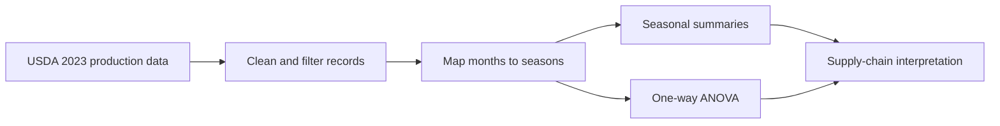

# 2023 U.S. Egg Production Seasonal Analysis

### Test whether seasonal patterns explain changes in U.S. egg production

[](https://www.python.org/)
[](https://docs.scipy.org/doc/scipy/reference/generated/scipy.stats.f_oneway.html)
[](https://www.nass.usda.gov/)

This project uses Python, pandas, and SciPy to evaluate whether monthly U.S. table-egg production changed significantly across Spring, Summer, Fall, and Winter in 2023. The analysis is framed for supply-chain and agricultural decision-makers who need to separate normal seasonal variation from other drivers of price volatility.

## Contents

- [Business question](#business-question)
- [Key result](#key-result)
- [Quick start](#quick-start)
- [Method](#method)
- [Technical workflow](#technical-workflow)
- [Project structure](#project-structure)
- [Limitations and known issues](#limitations-and-known-issues)
- [Contribution](#contribution)
- [Support](#support)
- [License](#license)

## Business question

If production is stable across seasons, a retail price spike may be driven by demand, feed costs, disease disruptions, or other supply-chain factors rather than a predictable production drop. This project tests that question with descriptive summaries and a one-way ANOVA.

## Key result

The one-way ANOVA produced **F = 0.017** and **p = 0.997**. The analysis failed to reject the null hypothesis, indicating no statistically significant difference in average monthly production across the four seasons in this 2023 sample.

Average monthly output remained in a similar range across seasons, roughly 278M to 291M eggs across the summarized producer groups.

## Quick start

### Prerequisites

- Python 3.10 or newer
- Git

```powershell
git clone https://github.com/rlaaudwp96/Egg-Production-Seasonal-Analysis.git
cd Egg-Production-Seasonal-Analysis
python -m venv .venv
.\.venv\Scripts\Activate.ps1
pip install -r requirements.txt
python egg_seasonal_analysis.py
```

## Method

1. Filter the USDA table-egg dataset to 2023.
2. Remove administrative and restricted entries marked `(D)`.
3. Convert production values to numeric values.
4. Map months to meteorological seasons.
5. Summarize seasonal distributions and run one-way ANOVA.

## Technical workflow



## Project structure

```text
Egg-Production-Seasonal-Analysis/
├── egg_data.csv               # USDA table-egg production data
├── egg_seasonal_analysis.py   # Reproducible Python analysis
├── requirements.txt           # pandas and SciPy dependencies
└── README.md
```

## Limitations and known issues

- The analysis covers one year, so it does not establish a long-term seasonal trend.
- Production data is not the same as retail price data.
- State-level output is highly uneven, which creates right-skewed distributions.
- The result should be interpreted with domain context rather than as a forecast.

## Contribution

Open an issue with a reproducible example, keep cleaning and modeling changes in `egg_seasonal_analysis.py`, and explain any change to the statistical assumptions in the pull request.

## Support

Use GitHub Issues or connect with [Myungje Kim on LinkedIn](https://www.linkedin.com/in/evan-kim-257857249/).

## License

No open-source license has been specified yet. Contact the repository owner before redistributing or adapting the code.
